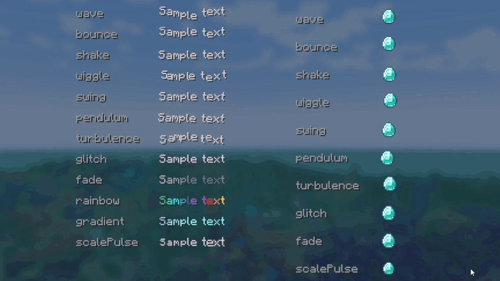

  

  

---

  

This is a client library created to simplify working with animations in the GUI via animators. It eliminates the need to manually manage timers, calculate progress, and interpolate values

The library supports two main tasks:
- The animation of arbitrary numerical values: position, transparency, scale, dimensions, angles, etc.
- Ready‑made visual effects such as waves, shaking, etc.

---

  

---

