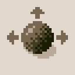
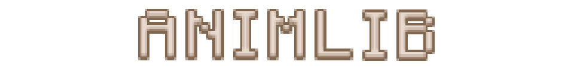
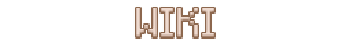

<p align="center">
  
</p>
<p align="center">
  
</p>

---

<p align="center">
  
</p>

---

The structure of the lib:
* `AnimationBuilder` - creates animations of numeric values
* `AnimatorRegistry` - stores a separate animator for each Screen
* `ScreenAnimator` - updates active screen animations
* `Animation` / `AnimatedValue` - calculate time, progress, and value
* `Easing` - a set of smooth curves
* `AnimEffects` - ready-made effects for text and textures

Each Screen gets its own `ScreenAnimator`. Thanks to this, animations on one screen do not affect another: for example, the pause menu, the custom GUI of the container, and the settings screen work in isolation  
`AnimatorRegistry` uses `WeakHashMap`, so the screen is not retained in memory by the library after it is no longer in use. For explicit cleanup, there is also `AnimLib.clear(screen)`

---

## Get Started

```java
public class ExampleScreen extends Screen {
    public ExampleScreen() {
    }

    @Override
    public void render(GuiGraphics graphics, int mouseX, int mouseY, float partialTick) {
        AnimLib.update(this);
        /* 
         * Updates all active animations of the specified screen on the current frame
         * Without it, numerical animations created
         * via AnimationBuilder will not progress over time
        */
    }

    @Override
    public void onClose() {
        AnimLib.clear(this)
        /*
         * Clear registered animator in this screen
         * this method is important. Because this will
         * improve the optimization of your screen.
         */
        super.removed();
    }
}
```

---

# AnimationBuilder

```java
private float posX = 0F;

@Override
protected void init() {
    AnimLib.animate(this)
            .from(0F)
            .to(120F)
            .duration(0.8F)
            .easeInOut()
            .bind(value -> posX = value)
            .start();
}
```
Available parameters:  
`from(float)` - Initial value  
`to(float)` - Final value  
`duration(float)` - Duration in seconds  
`bind(Consumer<Float>)`- The recipient of the new value  
`start()` - Adds the configured animation  
`value(from, to, duration, setter)` - Quickly adds a value without a separate start()  
`repeat(int)` - The number of repetitions for the **ONCE** mode or the number of full cycles for **PING_PONG**  
`loop()` - An endless cycle from beginning to end  
`pingPong()` - Movement from the beginning to the end and back  
`easing(...)` - Custom smoothness function  

# Animation modes
`ONCE` - the value goes from from to and stops   
`LOOP` - after reaching the time, it returns to the beginning  
`PING_PONG` - the value moves from from to to, then back to from  
After `ONCE` is completed, the animation is removed from `ScreenAnimator`. Cyclic animations remain active as long as the screen exists or until its animator is cleared!

# Easing / smoothness curves

`linear()` - uniform movement  
`easeIn()` / `cubicIn()` - slow start, quick finish  
`easeOut()` / `cubicOut()` - quick start, soft stop  
`easeInOut()` - smooth start and smooth stop  
`sineIn()` - soft start on a sine curve  
`sineOut()` - soft finish on a sine curve  
`sineInOut()` - sine smoothness on both sides  
`quadIn()` / `quadOut()` / `quadInOut()` - quadratic curve, softer than cubic  
`backIn()` - slightly pulls back before starting  
`backOut()` - slightly overshoots the target and returns  
`elasticOut()` - bouncy approach to the target  
`bounceIn()` / `bounceOut()` - simulates a bounce  


The names are slightly different, but the essence is clear...
In addition, you can delegate your function:
```java
.easing(progress -> progress * progress * progress)
```
The input and return values of the function represent progress from 0 to 1.

---

# Animated text
`AnimLib.drawText(...)` draws the string character by character. Before rendering each letter, its independent state is created (position, transparency, scale, rotation angle, color).  
The effects are applied in order. They can be combined.
```java
AnimLib.drawText(
        graphics,
        font,
        "Cookies!",
        x, y,
        0xFFFFFF,
        true,
        AnimEffects.wave(3f, 1.2f, 0.45f),
        AnimEffects.rainbow(0.12f, 0.06f)
);
```

# Effects

`wave(amplitude, speed, spacing)`	- a sinusoidal wave along the vertical axis  
`bounce(amplitude, speed, spacing)` - each letter bounces  
`shake(amplitude, speed)` - controlled tremor along X and Y  
`wiggle(amplitude, speed, spacing)` - oscillation along an individual direction  
`swing(angle, speed, spacing)` - the letters sway around the center  
`pendulum(angle, radius, speed)` - pendulum: rotation and, optionally, circular displacement  
`turbulence(amplitude, speed)` - uneven organic movement  
`glitch(frequency)` - glitch with rare jerks and blinking  
`glitch(frequency, jitterChance, blinkChance)` - a customizable glitch variant  
`fade(minAlpha, speed, spacing)` - soft transparency pulsation  
`pulse(minAlpha, speed, spacing)` - transparency pulsation  
`rainbow(speed, spacing)` - running HSV rainbow color  
`gradient(fromColor, toColor, speed)` - gradient between two RGB colors  
`scalePulse(min, max, speed, spacing)` - pulsating scale  

`Amplitude` is usually measured in pixels, `angle` in degrees, `speed` sets the rate of change, and `spacing` shifts the phase between adjacent letters.  
On 1.21.1, the gradient runs from the first color to the second and back, without a sudden color drop at the cycle boundary.

# Texture animation

`AnimLib.blit(...)` applies the same spatial effects to the texture: offset, scale, rotation, and transparency.

```java
@Override
public void render(GuiGraphics graphics, int mouseX, int mouseY, float partialTick) {
    AnimLib.update(this);
    
    AnimLib.blit(graphics, texture, x, y, width, height, effects);
    
    AnimLib.blit(
            graphics,
            MY_TEXTURE,
            20, 20,
            32, 32,
            AnimEffects.scalePulse(0.9f, 1.1f, 1f, 0f)
    );
    // the second one is intended for rendering part of the texture from the atlas

    super.render(graphics, mouseX, mouseY, partialTick);
}
```

---

# Creating your own effect

```java
public final class SwingOffsetEffect implements AnimEffect {
    private final float rotationDegrees;
    private final float horizontalOffset;
    private final float speed;
    private final float glyphSpacing;

    public SwingOffsetEffect(float rotationDegrees, float horizontalOffset, float speed, float glyphSpacing) {
        this.rotationDegrees = rotationDegrees;
        this.horizontalOffset = horizontalOffset;
        this.speed = speed;
        this.glyphSpacing = glyphSpacing;
    }

    @Override
    public void apply(TextRenderState state, TextEffectContext context) {
        float phase = context.getTime() * speed + context.getGlyphIndex() * glyphSpacing;

        state.rotate((float) Math.sin(phase) * rotationDegrees);
        state.moveX((float) Math.cos(phase) * horizontalOffset);
    }
}
```
Example of usage in the Screen:
```java
public class CustomEffectScreen extends Screen {
    private static final SwingOffsetEffect EFFECT = new SwingOffsetEffect(10f, 2f, 1f, 0.15f);

    public CustomEffectScreen() {
        super(Component.literal("Effect example"));
    }

    @Override
    public void render(GuiGraphics graphics, int mouseX, int mouseY, float partialTick) {
        renderBackground(graphics, mouseX, mouseY, partialTick);

        AnimLib.drawText(
                graphics, 
                font, 
                "Animated text",
                width / 2 - 50, height / 2,
                0xFFFFFF, true, 
                EFFECT
        );

        super.render(graphics, mouseX, mouseY, partialTick);
    }
}
```
